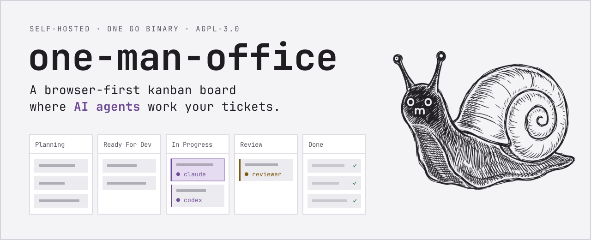
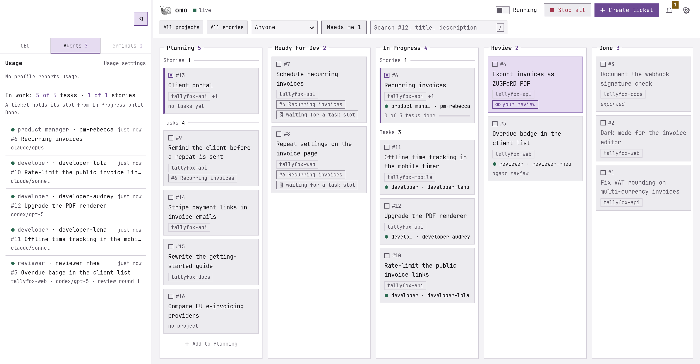
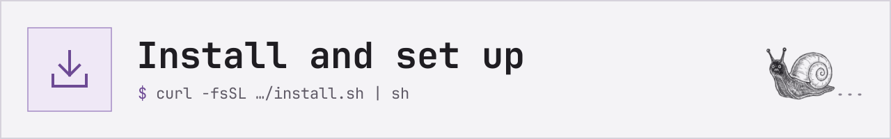
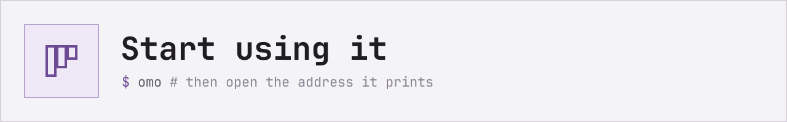
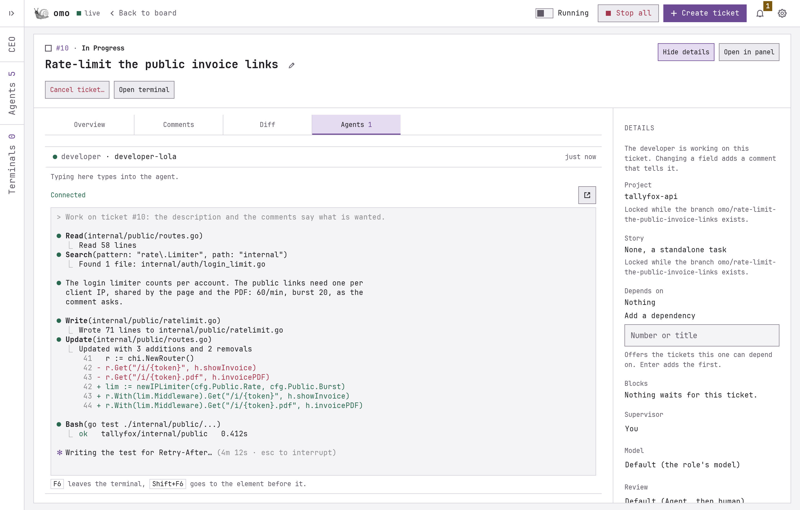
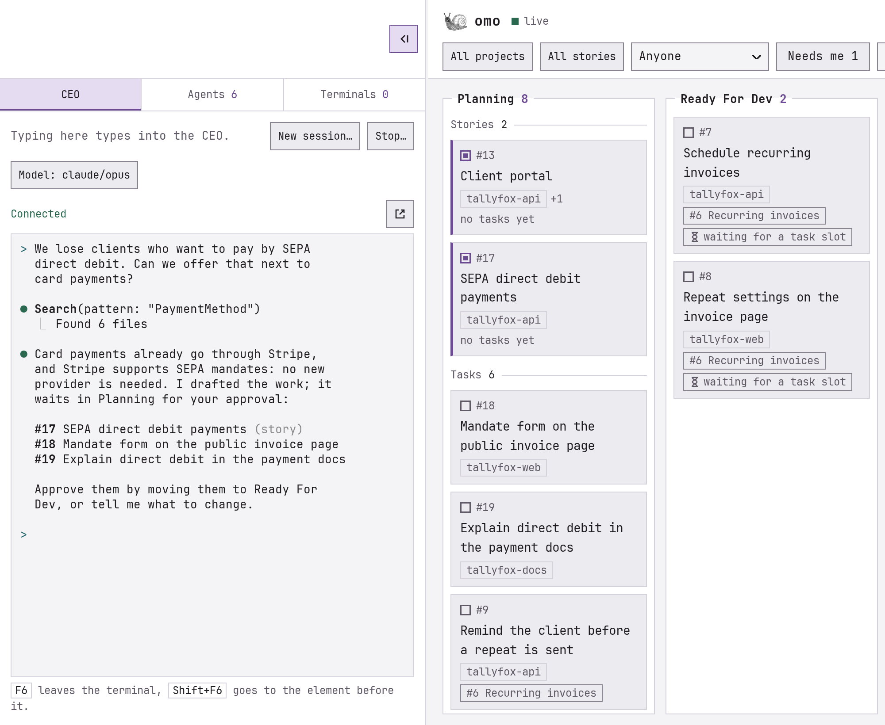
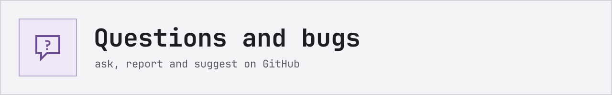
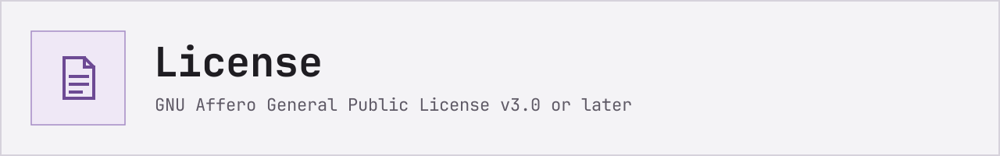

# one-man-office (omo)

<picture>
  <source media="(prefers-color-scheme: dark)" srcset=".github/assets/hero-dark.svg">
  
</picture>

<picture>
  <source media="(prefers-color-scheme: dark)" srcset=".github/assets/header-what-dark.svg">
  
</picture>

omo is a kanban board in your browser on which AI coding agents do the work.
You write tickets for your git repositories; omo starts Claude Code, Codex,
Antigravity or Gemini CLI on each one in a worktree of its own, has other
agents review the result, and merges it into your branch or opens a pull
request once you approve. It is one program that runs on your machine, as
you, for all your repositories at once.

> [!NOTE]
> **Looking for the TUI?** The terminal UI has been temporarily removed in recent versions in favor of the browser-first approach.
> Maintaining both interfaces while core features are still evolving during pre-release doesn't make sense right now, but bringing the TUI back is already planned before the `1.0` release.

<picture>
  <source media="(prefers-color-scheme: dark)" srcset=".github/assets/screenshot-board-dark.png">
  
</picture>

<picture>
  <source media="(prefers-color-scheme: dark)" srcset=".github/assets/header-install-dark.svg">
  
</picture>

You need Linux, macOS, or Windows, git 2.38 or newer, and at least one agent program installed and
signed in. While claude, codex, agy, and gemini work out of the box, any program is theoretically
supported with minimal manual configuration.

```bash
# Linux and macOS
curl -fsSL https://raw.githubusercontent.com/scolastico-dev/one-man-office/main/install.sh | sh
```

```powershell
# Windows PowerShell
irm https://raw.githubusercontent.com/scolastico-dev/one-man-office/main/install.ps1 | iex
```

The installer verifies the release checksum and puts `omo` into `~/.local/bin`
(`%LOCALAPPDATA%\Programs\omo` on Windows). Building from source, Docker and
updating: [Getting started](wiki/getting-started.md) and
[Running omo](wiki/running.md).

> [!WARNING]
> Agents run as your user, with their permission prompts switched off, and the
> board can run commands as you. omo listens on localhost only and requires its
> login token; keep it that way unless you control who can reach it. See
> [Security](wiki/security.md).

<picture>
  <source media="(prefers-color-scheme: dark)" srcset=".github/assets/header-start-dark.svg">
  
</picture>

```bash
omo -d                   # start in the background; prints the address with the login token
omo stop                 # stop it
omo autostart register   # enable user login autostart with the current server options
omo autostart unregister # disable user login autostart without stopping the running server
```

Open the printed address (`http://omo.localhost:8090/#…`). At the first start
omo finds your agent programs and sets them up. (If it finds the files of omo
0.11 it asks what to do with them first: see
[Upgrading from 0.11](wiki/upgrading-from-0.11.md).) The empty board then walks
you through the first steps: add the folder that holds your repositories, check
which models each role uses, and create a ticket. It waits in Planning: approve
it by dragging it to Ready For Dev, and watch the agent in the ticket's Agents
tab.

<picture>
  <source media="(prefers-color-scheme: dark)" srcset=".github/assets/screenshot-ticket-dark.png">
  
</picture>

When the agents are done, the ticket waits in Review for you: read the Diff
tab, then approve to merge. For bigger goals, write a story, or tell the CEO in
the sidebar what you want and approve the tickets it writes.

<picture>
  <source media="(prefers-color-scheme: dark)" srcset=".github/assets/screenshot-ceo-dark.png">
  
</picture>

The whole first ticket, step by step: [Getting started](wiki/getting-started.md).

<picture>
  <source media="(prefers-color-scheme: dark)" srcset=".github/assets/header-docs-dark.svg">
  
</picture>

The [wiki](wiki/README.md) is the manual:

- [Concepts](wiki/concepts.md): stories and tasks, roles, approval, reviews, limits
- [The board](wiki/board.md) and [Terminals](wiki/terminals.md)
- [Merging and export](wiki/merging-and-export.md): local merges and pull requests
- [Agents](wiki/agents.md), [Settings](wiki/settings.md), [Skill sets](wiki/skills.md), [Plugins](wiki/plugins.md), [MCP](wiki/mcp.md)
- [Running omo](wiki/running.md), [Command line](wiki/cli.md), [Backup](wiki/backup.md), [Troubleshooting](wiki/troubleshooting.md)
- [Upgrading from 0.11](wiki/upgrading-from-0.11.md)
- [Contributing](wiki/contributing.md)

<picture>
  <source media="(prefers-color-scheme: dark)" srcset=".github/assets/header-help-dark.svg">
  
</picture>

Questions, bug reports and suggestions are welcome on the
[issues page](https://github.com/scolastico-dev/one-man-office/issues).

<picture>
  <source media="(prefers-color-scheme: dark)" srcset=".github/assets/header-license-dark.svg">
  
</picture>

Copyright (C) 2026 Joschua Becker EDV.

Licensed under the [GNU Affero General Public License](LICENSE), version 3 or (at your option) any later version
(SPDX `AGPL-3.0-or-later`); see [NOTICE](NOTICE).
