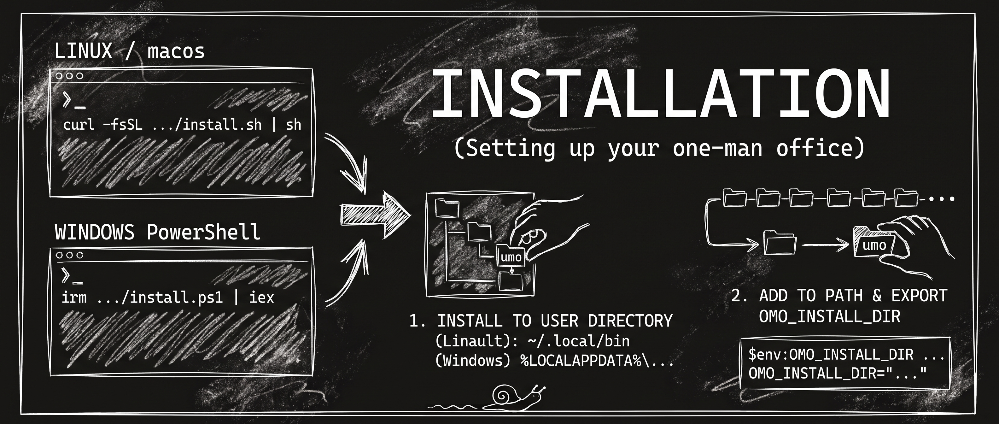

# one-man-office (omo)


A local board for running AI CLI agents on your Git repositories. `omo` is a single self-contained Go binary: one server per user that keeps tickets (stories and tasks) in SQLite and serves them through an HTTP API, an event stream, and the `omo ai` command for agents.

> [!NOTE]
> This version is a rework in progress. What works today: the server, its API and event stream, persistent settings, the board's ticket rules through the API and `omo ai`, the agent engine, and the board in the browser (live columns, creating and editing tickets, dragging them between columns). Not there yet: project discovery (projects are added in the board or through the API), comments, diffs and agent terminals in the browser, and settings pages. The `wiki/` folder still describes the earlier design and is outdated.

> [!WARNING]
> The address `omo` prints grants command execution with your permissions. By default the server listens on localhost only and requires the login token. Keep it that way unless you control who can reach the port.

## Install



### Linux and macOS

```bash
curl -fsSL https://raw.githubusercontent.com/scolastico-dev/one-man-office/main/install.sh | sh
```

Or download and inspect the script before running it:

```bash
curl -fsSLO https://raw.githubusercontent.com/scolastico-dev/one-man-office/main/install.sh
sh install.sh
```

### Windows PowerShell

```powershell
irm https://raw.githubusercontent.com/scolastico-dev/one-man-office/main/install.ps1 | iex
```

To inspect it first:

```powershell
Invoke-WebRequest https://raw.githubusercontent.com/scolastico-dev/one-man-office/main/install.ps1 -OutFile install.ps1
.\install.ps1
```

### What the installers do

- Detect the operating system and CPU architecture.
- Verify the latest release checksum.
- Install `omo` into a user-owned directory and add it to `PATH`.
- Keep the current release, or update it when a newer release is available, if you run the installer again.

Set `OMO_INSTALL_DIR` to choose a different installation directory. The defaults are `~/.local/bin` on Linux/macOS and `%LOCALAPPDATA%\Programs\omo` on Windows. Open a new shell after the first install so `PATH` changes take effect.

```bash
OMO_INSTALL_DIR="$HOME/bin" sh install.sh
```

```powershell
$env:OMO_INSTALL_DIR = "$HOME\bin"
.\install.ps1
```

`omo` must be on the `PATH` of the agents themselves because they invoke `omo ai` by name.

### Other ways to install

- **From source**: `make install PREFIX=~/.local`. Building the board needs Node.js 24 and npm; `make build NO_WEB=1` builds a binary without it.
- **Docker**: multi-architecture images, see `Dockerfile` and `compose.yml`. The container listens on port 8090.
- **Later updates**: `omo update` (`omo update --check` only reports).

## Quick start

```bash
omo -d             # start in the background; prints the address, the login token and the log path
omo                # or run in the foreground (Ctrl+C stops it)
omo stop           # stop the running server
```

The server prints `http://omo.localhost:<port>/#<token>` (and the same with `127.0.0.1`). The default port is 8090. The token is created at the first start, stored in `OMO_HOME/token` and reused, so the address keeps working across restarts. A second `omo` prints the running server's address. Open the address in a browser to see the board; its first steps add a project and create the first ticket.

Projects (Git repositories) can also be added through the API, and tickets handled with `omo ai`:

```bash
TOKEN=$(cat ~/.local/omo/token)
curl -H "Authorization: Bearer $TOKEN" -H 'Content-Type: application/json' \
  -d '{"path":"/path/to/repo"}' http://127.0.0.1:8090/api/projects

omo ai project list
omo ai ticket create --type story --title "Login" --project my-repo
omo ai ticket create --type task --title "Form" --project my-repo --story 1
omo ai ticket list
omo ai ticket move 1 ready
omo ai comment 1 "@pm please split this"
omo ai comments 1
```

`omo ai` talks to the running server over a local socket and never starts one. Without `OMO_AGENT_ID` it acts as the user; with it, as that agent. Every `omo ai` command takes `--json`; text written by people or agents is printed indented by four spaces. `omo ai ticket update --base-version N` refuses a description change when someone else changed it after you read version N. `omo ai ticket cancel` and `omo ai ticket retry` cancel a ticket and retry its failed step. Run `omo ai --help` for all verbs.

### Commands

| Command | What it does |
|---|---|
| `omo`, `omo -d` | start the server in the foreground or the background |
| `omo stop` | stop the running server |
| `omo config list\|get\|set\|unset` | start options: `host`, `port`, `auth` (`token`, `basic`, `none`), `basic_auth`, `origin_check`, `allowed_hosts`; changes apply at the next start |
| `omo config rotate-token` | replace the login token (applies at the next start) |
| `omo autostart register\|unregister` | start omo at user login |
| `omo update [--check] [--version TAG]` | install a verified release |
| `omo ai ...` | board commands for agents: `ticket`, `link`, `comment`, `comments`, `ask`, `done`, `whoami`, `project`, `model`, `ready`, `wait` |

### Where state lives

Everything is in `OMO_HOME` (default `~/.local/omo`, `%APPDATA%\omo` on Windows; an absolute `OMO_HOME` overrides): `omo.db` (tickets), `server.yaml`, `token`, `settings.yaml`, `projects/`, `profiles/`, `roles/`, `prompts/`, and `run/` (lock, log, socket). Nothing is written into your projects. If `OMO_HOME` holds an installation of an older omo, this version refuses to use it; set `OMO_HOME` to another folder.

## Documentation

The [wiki](wiki/README.md) documents the earlier office-based design and is outdated; it is being rewritten. [CLAUDE.md](CLAUDE.md) describes the current architecture for contributors.

## License

Copyright (C) 2026 Joschua Becker EDV.

Licensed under the [GNU Affero General Public License v3.0 or later](LICENSE).
