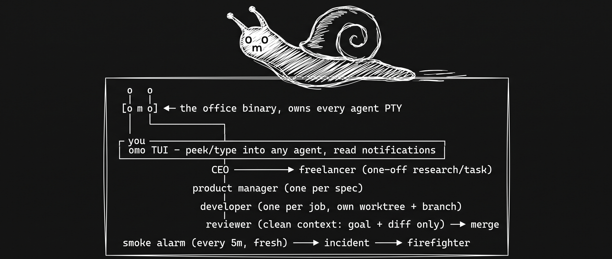

# one-man-office (omo)



A local board for running AI CLI agents on your Git repositories. `omo` is a single self-contained Go binary: one server per user that keeps tickets (stories and tasks) in SQLite and serves them through an HTTP API, an event stream, and the `omo ai` command for agents.

> [!NOTE]
> This version is a rework in progress. What works today: the server, its API and event stream, persistent settings, the board's ticket rules through the API and `omo ai`, the agent engine, and the board in the browser (live columns, creating and editing tickets, dragging them between columns, a ticket's comments, diff, agents and tasks, agent and user terminals, notifications), and the settings pages (workspace folders and projects, agents, roles, prompts, environment, limits, review and general). The `wiki/` folder still describes the earlier design and is outdated.

> [!WARNING]
> The address `omo` prints grants command execution with your permissions. By default the server listens on localhost only and requires the login token. Keep it that way unless you control who can reach the port.

## Install


### Linux and macOS

```bash
curl -fsSL https://raw.githubusercontent.com/scolastico-dev/one-man-office/main/install.sh | sh
```

Or download and inspect the script before running it:

```bash
curl -fsSLO https://raw.githubusercontent.com/scolastico-dev/one-man-office/main/install.sh
sh install.sh
```

### Windows PowerShell

```powershell
irm https://raw.githubusercontent.com/scolastico-dev/one-man-office/main/install.ps1 | iex
```

To inspect it first:

```powershell
Invoke-WebRequest https://raw.githubusercontent.com/scolastico-dev/one-man-office/main/install.ps1 -OutFile install.ps1
.\install.ps1
```

### What the installers do

- Detect the operating system and CPU architecture.
- Verify the latest release checksum.
- Install `omo` into a user-owned directory and add it to `PATH`.
- Keep the current release, or update it when a newer release is available, if you run the installer again.

Set `OMO_INSTALL_DIR` to choose a different installation directory. The defaults are `~/.local/bin` on Linux/macOS and `%LOCALAPPDATA%\Programs\omo` on Windows. Open a new shell after the first install so `PATH` changes take effect.

```bash
OMO_INSTALL_DIR="$HOME/bin" sh install.sh
```

```powershell
$env:OMO_INSTALL_DIR = "$HOME\bin"
.\install.ps1
```

`omo` must be on the `PATH` of the agents themselves because they invoke `omo ai` by name.

### Other ways to install

- **From source**: `make install PREFIX=~/.local`. Building the board needs Node.js 24 and npm; `make build NO_WEB=1` builds a binary without it.
- **Docker**: multi-architecture images, see `Dockerfile` and `compose.yml`. The container listens on port 8090.
- **Later updates**: `omo update` (`omo update --check` only reports).

## Quick start

```bash
omo -d             # start in the background; prints the address, the login token and the log path
omo                # or run in the foreground (Ctrl+C stops it)
omo stop           # stop the running server
```

The server prints `http://omo.localhost:<port>/#<token>` (and the same with `127.0.0.1`). The default port is 8090. The token is created at the first start, stored in `OMO_HOME/token` and reused, so the address keeps working across restarts. A second `omo` prints the running server's address. Open the address in a browser to see the board; its first steps add a project and create the first ticket.

Agents are AI CLIs (Claude Code, Codex, Gemini or any command) described by profiles in `OMO_HOME/profiles/` and assigned to the roles CEO, product manager, developer and reviewer in `OMO_HOME/roles/`. You rarely edit these files: the settings pages do it (see Settings). Once a ticket is approved (moved to Ready), the server's engine does the rest: a story gets a product manager who writes and releases its tasks; each task gets a developer in its own worktree and branch under `OMO_HOME/worktrees`, then a reviewer, and is merged into its story's branch, the story into its base branch (or exported as a pull request when the ticket says so). At most `max_running_agents` (in `settings.yaml`) agents start new work at a time; agents of work already started (reviewers, a developer after a rejection) are never held back. omo merges without checking anything out: the only git command it runs in your own folder is `git merge --ff-only`, and only when nothing there is in the way. A step that needs a person (a blocked merge, an agent that keeps crashing) flags the ticket; fix the cause and retry it. The engine needs git 2.38 or newer.

`omo stop` (or Ctrl+C) asks every working agent for a handoff comment and waits for it at most `stop.handoff_timeout` (2 minutes by default) before it ends the agents; a second `omo stop` or Ctrl+C skips that wait. At the next start, every ticket that was in progress gets a fresh agent that is told to read the handoff and keep uncommitted changes.

Projects (Git repositories) are found in workspace folders (see Settings), added one by one in the browser, or added through the API; tickets are handled with `omo ai`:

```bash
TOKEN=$(cat ~/.local/omo/token)
curl -H "Authorization: Bearer $TOKEN" -H 'Content-Type: application/json' \
  -d '{"path":"/path/to/repo"}' http://127.0.0.1:8090/api/projects

omo ai project list
omo ai ticket create --type story --title "Login" --project my-repo
omo ai ticket create --type task --title "Form" --project my-repo --story 1
omo ai ticket list
omo ai ticket move 1 ready
omo ai comment 1 "@pm please split this"
omo ai comments 1
```

`omo ai` talks to the running server over a local socket and never starts one. Without `OMO_AGENT_ID` it acts as the user; with it, as that agent. Every `omo ai` command takes `--json`; text written by people or agents is printed indented by four spaces. `omo ai ticket update --base-version N` refuses a description change when someone else changed it after you read version N. `omo ai ticket cancel N [--delete-branch [--discard-uncommitted]]` cancels a ticket (a worktree with uncommitted changes and its branch are kept unless the user also passes `--discard-uncommitted`), `omo ai ticket retry N` retries its failed step, and `omo ai ticket list --supervisor user|ceo|pm` lists the tickets a role supervises. Agents use `omo ai ready`, `omo ai wait` and `omo ai done` (export agents with `--url` or `--failed`). Run `omo ai --help` for all verbs.

### The board

Opening a ticket shows its description and fields, and tabs for Comments, Diff, Agents and Tasks (stories only). Comments are Markdown; `@user`, `@pm`, `@developer`, `@reviewer`, `@supervisor` and `@ceo` notify someone, and a comment can be at most 64 KiB. A question from an agent shows in Comments with an Answer button. The Diff tab shows the branch's changes and the changes not yet committed in the worktree; large diffs are cut and say so. The Agents tab shows a running agent's terminal (typing there types into the agent) or the saved log of one that ended.

The sidebar next to the board has three tabs: CEO, Agents and Terminals. The CEO starts only when you open its tab. Agents lists the running agents and their slots. Terminals holds your own shells, in a project's folder or in a ticket's worktree (the ticket's Open terminal action). A shell in a worktree keeps that worktree: the ticket can still merge and finish, and omo removes the folder when the last shell in it ends. On a narrow screen the sidebar opens as a sheet from the top bar.

The bell in the top bar lists what waits for you (questions, reviews, flagged tickets) and mentions of you. Desktop notifications are off until you switch them on in that browser.

Only you can open shells and read terminals and agent logs; an agent session gets 403 for them. Text from agents and other people is shown with hidden and control characters written out, and text pasted into a terminal is cleaned of control characters first.

### Settings

The gear in the top bar opens the settings. Everything that was a file in `OMO_HOME` can be changed there; the files stay the source, and a hand edit shows up on an open page within a few seconds.

- **Projects**: workspace folders and the projects in them. Add a folder (type its path or pick it with Browse) and omo looks in it for Git repositories, down to a search depth you set (4 by default, at most 16), at start, at an interval you set, when the folders change, and on Rescan. Every repository found becomes an enabled project. It does not look inside a repository, does not follow links, and skips folders that match an ignore pattern (`node_modules` and folders starting with a dot by default). A scan has time and size limits; the report on the page says what was cut. You can switch a found project off; to drop it for good, add an ignore pattern. Projects can still be added one by one.
- **Agents**: profiles (the program, its arguments, environment and account folder) and their models. "Detect agent programs" looks for `claude`, `codex` and `gemini` on `PATH` and writes a profile for each one that has none. The same happens once at the very first start of omo on a home. The profiles it writes start the programs with the argument that skips their permission prompts, so agents can work without asking you; look at them before you start agents on a repository you care about.
- **Roles**: which models each role uses, in which order, and how one is picked.
- **Prompts**: your own instructions for each role and the messages omo sends; a preview shows the result with sample data.
- **Environment**: variables every agent starts with. Values are plain text, shown as they are stored. These can hold `$VAR` and backtick commands, which omo expands (and runs) when an agent starts; "Check" runs them and tells you if each variable ends up set. Variables set in a profile or a model are used as written.
- **Limits**, **Review** and **General**: how many agents run at once and the time limits, the review and release defaults for new tickets, and the CEO switch, the theme and server facts.

A save is refused, with the reason under the field, when the file changed on disk since the page loaded it. An open page keeps your unsaved edits when the file changes and offers the new value. Leaving a page with unsaved edits asks first.

Prompts, the environment and the profiles are commands that run as you, so only you can read or change them through the API; an agent can only list the projects and the models it may choose. This is a guard rail and not a security boundary: agents run as your user, can talk to the socket without their session header and can write the files in `OMO_HOME`. Do not run an agent you do not trust.

### Commands

| Command | What it does |
|---|---|
| `omo`, `omo -d` | start the server in the foreground or the background |
| `omo stop` | stop the running server after the agents' handoff (a second `omo stop` skips the wait) |
| `omo config list\|get\|set\|unset` | start options: `host`, `port`, `auth` (`token`, `basic`, `none`), `basic_auth`, `origin_check`, `allowed_hosts`; changes apply at the next start |
| `omo config rotate-token` | replace the login token (applies at the next start) |
| `omo autostart register\|unregister` | start omo at user login |
| `omo update [--check] [--version TAG]` | install a verified release |
| `omo ai ...` | board commands for agents: `ticket`, `link`, `comment`, `comments`, `ask`, `done`, `whoami`, `project`, `model`, `ready`, `wait` |

### Where state lives

Everything is in `OMO_HOME` (default `~/.local/omo`, `%APPDATA%\omo` on Windows; an absolute `OMO_HOME` overrides): `omo.db` (tickets), `server.yaml`, `token`, `settings.yaml`, `projects/`, `profiles/`, `roles/`, `prompts/`, `run/` (lock, log, socket), `worktrees/` (the agents' worktrees), `ceo/` (the CEO agent's folder) and `logs/` (agent transcripts). Nothing is written into your projects. If `OMO_HOME` holds an installation of an older omo, this version refuses to use it; set `OMO_HOME` to another folder.

## Documentation

The [wiki](wiki/README.md) documents the earlier office-based design and is outdated; it is being rewritten. [CLAUDE.md](CLAUDE.md) describes the current architecture for contributors.

## License

Copyright (C) 2026 Joschua Becker EDV.

Licensed under the [GNU Affero General Public License v3.0 or later](LICENSE).
